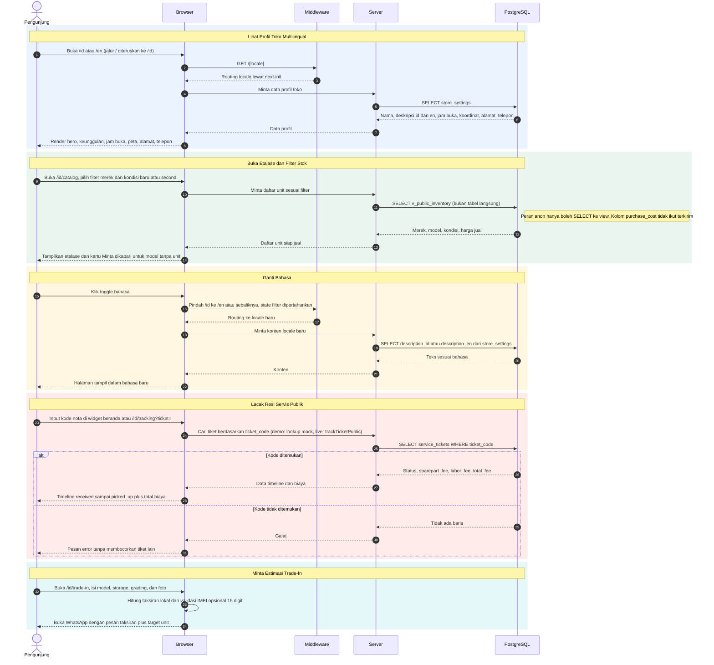
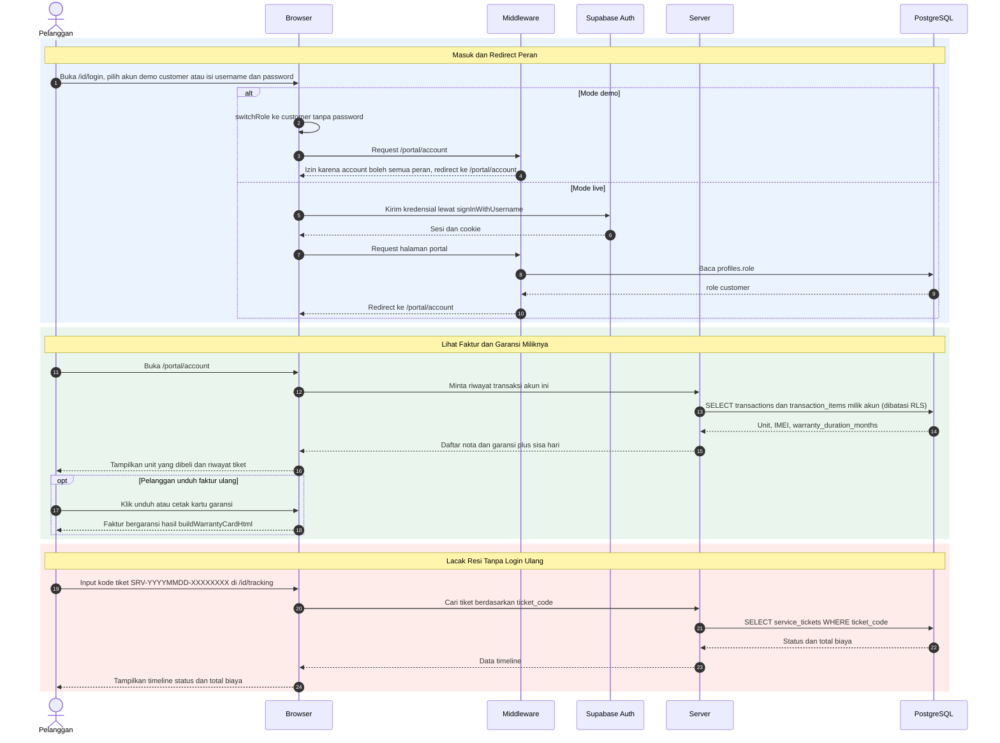
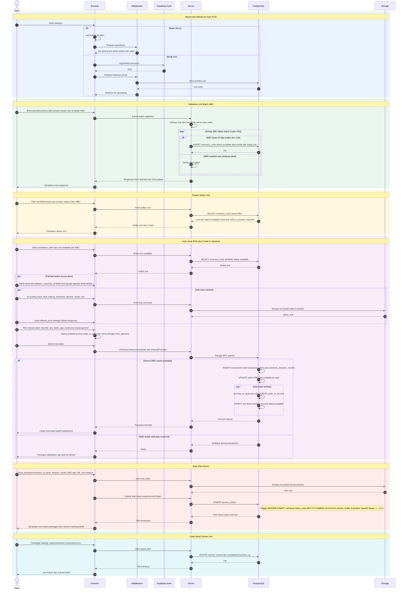
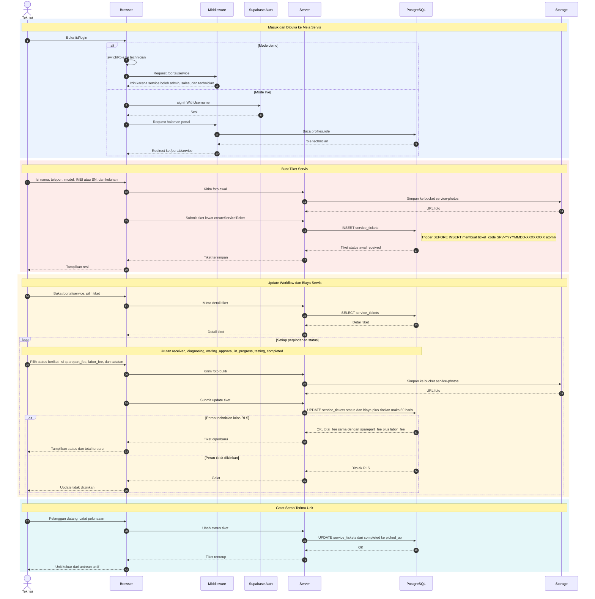
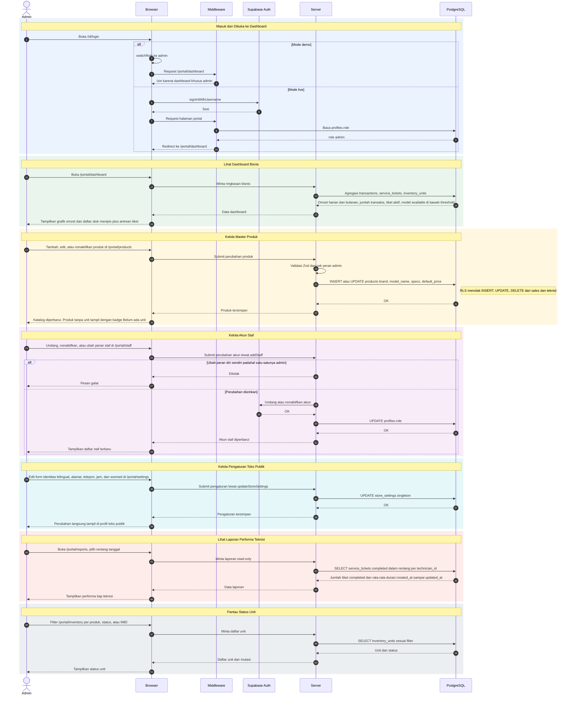

# Sequence Diagram - At Cell Web

Dokumen ini berisi lima sequence diagram, satu untuk setiap aktor.
Isinya sudah diverifikasi ke source code pada 13 Oktober 2026.

Sumber acuan: `src/proxy.ts`, `src/lib/access.ts`,
`src/lib/login-redirect.ts`, `src/app/(public)/[locale]/*/page.tsx`,
`src/app/(portal)/portal/*/page.tsx`,
`src/components/portal/login-panel.tsx`, `src/lib/store.ts`,
`src/lib/actions/`, `src/types/index.ts`, `supabase/migrations/`.
Mode demo memakai mock dan `localStorage`. Mode live memakai
Supabase Auth, RLS, dan Server Actions.

## Cakupan per aktor

### Pengunjung

Pengunjung adalah publik anonim tanpa login. Pengunjung dapat membuka web,
melihat profil toko, membuka etalase dan filter, ganti bahasa,
lacak resi servis, minta estimasi trade-in lewat WhatsApp,
serta membaca halaman info garansi, pembayaran, pengiriman,
syarat, kontak, dan layanan pelanggan.

### Pelanggan

Pelanggan adalah akun dengan peran customer. Pelanggan dapat masuk lewat
pintu login, membuka faktur dan garansi miliknya, mengunduh faktur ulang,
serta lacak resi servis tanpa perlu login ulang.

### Sales

Sales adalah kasir dan inventaris. Sales dapat masuk dan langsung dibuka
ke kasir POS, memilih unit siap jual per IMEI, mencatat pembeli walk-in,
memproses trade-in sebagai diskon, checkout atomik dan cetak nota,
mendaftarkan unit batch IMEI, memantau status unit, membuat tiket servis,
serta mencatat serah terima unit.

### Teknisi

Teknisi adalah meja servis. Teknisi dapat masuk dan langsung dibuka
ke meja servis, membuat tiket servis baru, mengupdate workflow dan biaya
plus foto bukti, serta mencatat serah terima unit.

### Admin

Admin adalah owner dengan kendali penuh. Admin dapat masuk dan langsung
dibuka ke dashboard, melihat ringkasan bisnis dan stok menipis,
mengelola master produk, mengundang dan mengelola staf,
mengelola pengaturan toko publik, melihat laporan performa teknisi,
memantau status unit, serta membuka semua menu POS, inventaris,
servis, dan akun.

## Keterangan Participant

| Participant | Arti |
| ----------- | ---- |
| Browser | Antarmuka web (Next.js App Router, React) di sisi pengguna |
| Middleware | Proxy Next.js di `src/proxy.ts`: redirect `/` ke `/id`, redirect `/portal/login` ke `/id/login`, rewrite subdomain login ke `/id/login` |
| Server | Sisi server Next.js: Server Actions dan Route Handlers (validasi Zod, cek peran lewat `requireRole`) |
| Supabase Auth | Autentikasi Supabase untuk mode live |
| PostgreSQL | Database Supabase dengan Row Level Security (RLS) |
| Storage | Supabase Storage (bucket `trade-in-photos` dan `service-photos`) |

Catatan mode: alur login di bawah menulis dua cabang.
Cabang demo memakai `switchRole` tanpa password lewat klik akun demo.
Cabang live memakai `signInWithUsername` lalu cek `profiles.role`.

---

## Diagram Aktor: Pengunjung

---

## Diagram Aktor: Pelanggan

---

## Diagram Aktor: Sales

---

## Diagram Aktor: Teknisi

---

## Diagram Aktor: Admin

---

## Status Verifikasi

Verifikasi 13 Oktober 2026 memakai tiga agen eksplorasi yang membaca
`src/proxy.ts`, `src/lib/access.ts`, `src/lib/login-redirect.ts`,
`src/app/(public)/[locale]`, `src/app/(portal)/portal`,
`src/components/portal/login-panel.tsx`, `src/lib/store.ts`,
`src/lib/actions`, dan `src/types/index.ts`.

Yang diperbaiki dari naskah asal di folder Downloads:

- Jalur portal mengikuti kode: `/portal/dashboard`, `/portal/pos`,
  `/portal/inventory`, `/portal/service`, `/portal/products`,
  `/portal/staff`, `/portal/settings`, `/portal/reports`,
  `/portal/account`. Naskah asal memakai jalur tanpa awalan `/portal`.
- Mekanisme login mengikuti `src/proxy.ts` dan `login-panel.tsx`:
  `/portal/login` diteruskan ke `/id/login`, subdomain login ditulis ulang
  ke `/id/login`, demo memakai `switchRole` tanpa password,
  live memakai `signInWithUsername`, redirect memakai `defaultPortalPath`
  dan `?next=` yang divalidasi `canAccessPortalPath`.
- Hak akses menu mengikuti `canAccessPortalPath`: account semua peran,
  dashboard dan produk dan staf dan settings dan reports khusus admin,
  pos dan inventory untuk admin dan sales,
  service untuk admin dan sales dan technician.
- Aturan bisnis mengikuti kode: IMEI tepat 15 digit angka dan unik,
  batch maks 200 baris, `executePosSale` menolak unit selain available,
  kode tiket `SRV-YYYYMMDD-XXXXXXXX` dengan sufiks base32 tanpa I, L, O, U,
  alur `received, diagnosing, waiting_approval, in_progress, testing,
  completed, picked_up` plus `cancelled`,
  bucket `trade-in-photos` dan `service-photos`.
- Estimasi trade-in publik bersifat hitung lokal plus pesan WhatsApp,
  bukan insert database. Insert trade-in hanya terjadi di POS portal.
- Kode bernomor dihapus dari semua judul, tabel, dan diagram
  sesuai permintaan. Judul memakai kalimat langsung seperti
  Pengunjung dapat membuka web.
